# [CH 2] 모듈 3 과제 보고서 — 설정값에 따른 Mask와 검출 결과 변화 분석

- 작성자: 정수용
- 작성일: 2026-10-12

---

## 1. 실행 환경과 입력

### 1-1. 코드·실행 명령

| 항목            | 내용                                                                                                                                                                                                                             |
| ------------- | ------------------------------------------------------------------------------------------------------------------------------------------------------------------------------------------------------------------------------ |
| 사용한 저장소       | https://github.com/SpartaPA/physicalai-lv2-SuYongChung                                                                                                                                                                         |
| 커밋 해시         | 2394ee1<br>2394ee167e068f6fb7dbb01a40d1829793bf4d07                                                                                                                                                                            |
| 비전 노드 파일      | `lv2_module3/vision_node.py` (19·21강 교안 기반 자체 구성, 자세한 내용은 README.md)                                                                                                                                                           |
| 실행 명령         | python3 vision_node.py --ros-args   -p image_topic:=/camera/camera/color/image_raw   -p hsv_lower1:="[100,150,50]" -p hsv_upper1:="[130,255,255]"   -p hsv_lower2:="[100,150,50]" -p hsv_upper2:="[130,255,255]" (실험에 쓴 값: 파랑) |
| 실행 명령 (비전 노드) | `python3 vision_node.py --ros-args -p image_topic:=/camera/camera/color/image_raw`                                                                                                                                             |
| 모터 제어 노드      | 실행하지 않음                                                                                                                                                                                                                        |

### 1-2. 실행 환경

| 항목     | 버전               |
| ------ | ---------------- |
| OS     | Ubuntu 24.04 LTS |
| ROS 2  | Lyrical          |
| Python | python 3.12.3    |
| OpenCV | 4.6.0            |

### 1-3. 입력 자료

| 항목                 | 내용                                                                  |
| ------------------ | ------------------------------------------------------------------- |
| 입력 종류              | Camera (실시간)                                                        |
| 출처                 | Intel RealSense D435 (`lsusb`: 8086:0b07), `realsense2_camera` 드라이버 |
| 관찰 구간·프레임          | 정지한 장면. Raw·Mask·Overlay 캡처: 2026-10-12 12:08~12:09, `detection_echo.txt`는 같은 정지 장면에서 약 5분 뒤 저장 (시각 근거: 해당 파일의 stamp 1791774854, KST 12:14 환산)       |
| 해상도                | 640×480 (width 640, height 480)                                     |
| Camera 사용 시 고정한 조건 | 위치: PA강의실 앞쪽 책상 위, 조명: 실내 조명, 노출(IRS D435): 자동. 실시간 Camera는 입력이 프레임마다 달라 결과에 영향을 줄 수 있으므로 장면을 움직이지 않고 고정함                      |
| 실시간/재생 구분          | 실시간 Camera                                                          |

---

## 2. 토픽 구성

확인 명령: `ros2 topic list -t`, `ros2 topic info <토픽명> --verbose`

| 자료              | 토픽 이름                            | 메시지 타입                           | 발행 노드                                          | 수신 도구                      |
| --------------- | -------------------------------- | -------------------------------- | ---------------------------------------------- | -------------------------- |
| Raw Image       | `/camera/camera/color/image_raw` | `sensor_msgs/msg/Image`          | `camera` (namespace `/camera`, RealSense 드라이버) | 이미지 토픽 뷰어 (rqt_image_view) |
| Mask            | `/mask`                          | `sensor_msgs/msg/Image`          | `color_detector` (`vision_node.py`)            | 이미지 토픽 뷰어 (rqt_image_view) |
| 검출 결과 (수치)      | `/detection`                     | `geometry_msgs/msg/PointStamped` | `color_detector` (`vision_node.py`)            | ros2 topic echo            |
| 검출 결과 (Overlay) | `/image_annotated`               | `sensor_msgs/msg/Image`          | `color_detector` (`vision_node.py`)            | rqt_image_view             |


- QoS 확인 결과:
    - `/camera/camera/color/image_raw` 발행(`camera`): RELIABLE, KEEP_LAST(1), TRANSIENT_LOCAL
    - 같은 토픽 구독(`color_detector`): BEST_EFFORT, KEEP_LAST(5), VOLATILE
    - `/mask`, `/image_annotated` 발행: RELIABLE, KEEP_LAST(1), VOLATILE / `/detection` 발행: RELIABLE, KEEP_LAST(10), VOLATILE
    - 토픽 목록에 `/camera/color/image_raw`와 `/tracking/*`, `/tracker_node`가 함께 보이나 이는 같은 네트워크의 다른 노드가 발행한 것으로 이번 실험에는 사용하지 않음
- 토픽 정보 파일: `results/topic_info.txt`

### 2-1. Raw Image 수신 확인

- 캡처:  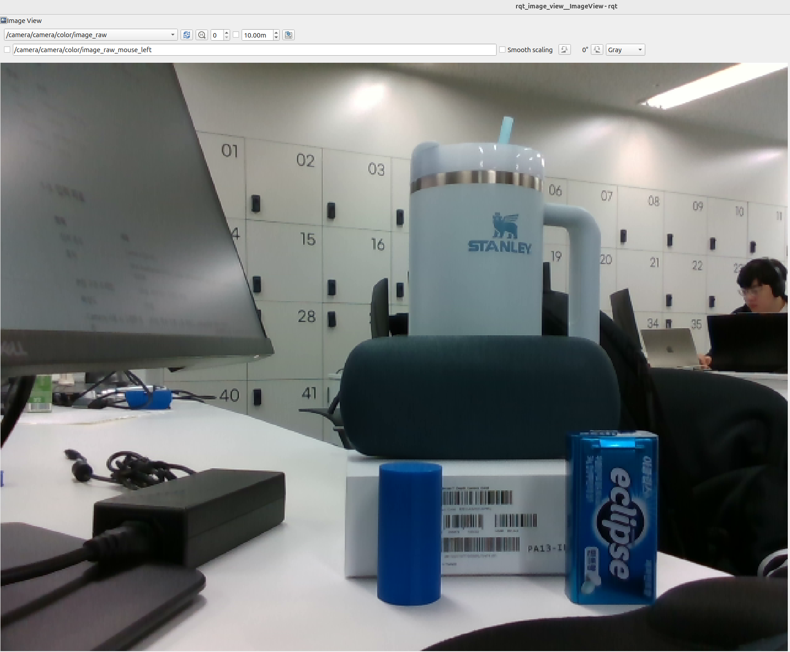
- 해상도 / encoding: 640×480 (width 640, height 480) / rgb8, step 1920 (= 640×3)
- 원본 장면 설명 (목표 물체와 배경, 2~3문장): 목표 물체는 파란색 원통 모양의 퍽이다. 그 옆에 파란색 eclipse통과 하늘색 텀블러, 왼쪽 뒷부분에 파란색 물체가 있다.

### 2-2. Mask 수신 확인

- 캡처:
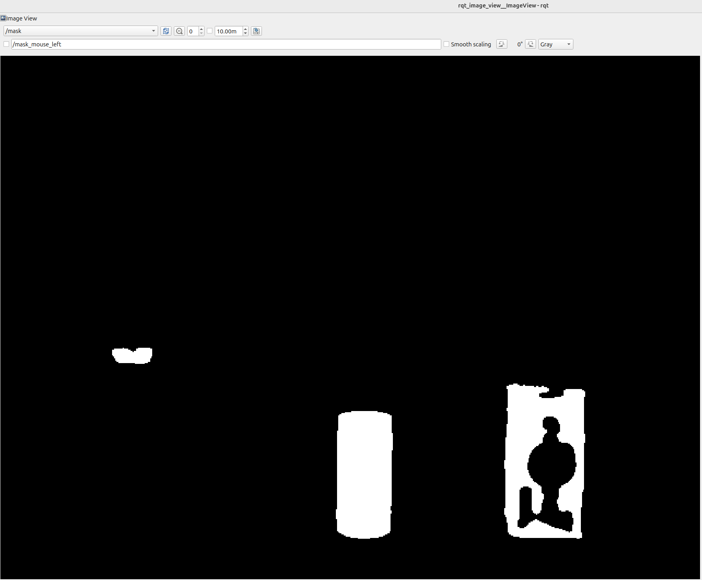
- Mask의 흰색(전경)·검은색(배경)의 의미 (실제 값과 코드 기준): 흰색(255)은 HSV가 지정 범위 `[100,150,50] ~ [130,255,255]` 안인 픽셀이고 검정(0)은 범위 밖 픽셀이다. `/mask`는 mono8(0/255)이다. 근거: `vision_node.py` 56~57줄 `inRange`, 60~61줄 열림·닫힘 연산
- 원본 대비 Mask에 남은 영역: Raw에서 파란색 계열 물체만 흰색으로 남고 나머지는 검정이다. 질감·그림자·글씨 같은 정보는 사라지고 색 조건만 남는다.
- 목표 외에 함께 남은 영역 / 누락된 영역: 
    - 로그로 확인한 것: `contours=3, drop_area=1, drop_circ=1`
    - 남은 영역: 왼쪽 뒤 파란색 물체, eclipse 통(추정)
    - 누락된 영역: eclipse 통의 글씨, 로고 자리의 구멍(추정)
- Mask 토픽이 발행되는 처리 단계 (검출 후보 필터 이전인지 이후인지): 필터 이전(vision_node.py의 94줄 -> 99줄, 필터는 73, 78줄)

### 2-3. 검출 결과 수신 확인

- `ros2 interface show geometry_msgs/msg/PointStamped 결과`:
```
std_msgs/Header header
	builtin_interfaces/Time stamp
		int32 sec
		uint32 nanosec
	string frame_id
Point point
	float64 x
	float64 y
	float64 z

```

- 실제 수신 메시지 예시 (`results/detection_echo.txt`):

```
header:
  stamp:
    sec: 1791774854
    nanosec: 992243408
  frame_id: camera_color_optical_frame
point:
  x: 332.46217376940865
  y: 382.39778358410666
  z: 0.0
```

| 필드                            | 의미                                                  | 단위               |
| ----------------------------- | --------------------------------------------------- | ---------------- |
| `header.stamp` (sec, nanosec) | 입력 Raw 이미지의 타임스탬프. 코드에서 pt.header = msg.header로 복사함 | 초, 나노초 (Unix 시간) |
| header.frame_id               | 좌표계 이름. 값은 `camera_color_optical_frame`             | 없음               |
| point.x                       | 검출된 물체 중심의 가로 위치                                    | px               |
| point.y                       | 검출된 물체 중심의 세로 위치                                    | px               |
| point.z                       | 사용 안 함. 항상 0.0 (깊이 아님)                              | 없음               |

- Overlay의 중심점·박스와 Raw Image 목표 위치 일치 여부: 일치한다. Overlay 캡처에서 초록 점은 이미지 표시 영역 기준으로 대략 (925, 1205)이다. 표시 배율(1780/640 ≈ 2.78)로 환산하면 x ≈ 332.7, y ≈ 382.4이다(위쪽 툴바 높이 약 142 제외). 이는 echo의 x=332.5, y=382.4와 거의 같으므로 일치한다.
- 수치 메시지가 제공되지 않는 구성이라면 그 사실을 여기에 기록: 해당 없음
- 캡쳐
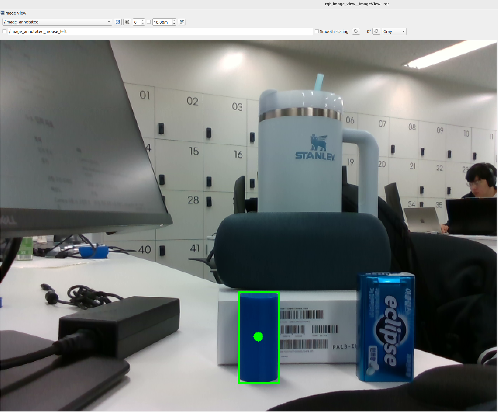

---

## 3. 코드 흐름과 설정값 위치

### 3-1. 데이터 흐름도

```
Raw Image 토픽 (/camera/camera/color/image_raw)   (구독 41~42줄)
        │  (cv_bridge 변환: imgmsg_to_cv2(..., "bgr8"), 93줄)
        ▼
BGR → HSV 변환            (55줄 cvtColor)
        ▼
inRange(lower, upper)     (56~57줄, 58줄 OR, 60~61줄 열림·닫힘)   ← 실험 1에서 변경
        ▼
Mask  ──► Mask 토픽       (94줄에서 생성 → 99줄 /mask 발행)
        ▼
findContours · 면적 계산  (69줄 findContours, 72줄 contourArea)
        ▼
면적 필터 (min_area)      (73줄)   ← 실험 2에서 변경
        ▼
원형도 필터 (min_circularity)  (76~78줄)
        ▼
후보 선택(가장 큰 것)·중심 계산  (81~82줄, 86~87줄)
        ▼
검출 결과 ──► 검출 토픽   (106줄 /detection)
        └──► Overlay 토픽 (118~120줄 /image_annotated)
```


### 3-2. 설정값 읽는 위치와 적용 시점

| 설정값                          | 정의·사용 위치 (파일:줄)      | 값을 바꾸는 방법 (파라미터 / 설정 파일 / 상수)              | 읽는 시점 (시작 시 1회 / 매 프레임)                      | 재시작 필요 여부 |
| ---------------------------- | -------------------- | ------------------------------------------ | -------------------------------------------- | --------- |
| HSV 하한/상한                    | 정의 29~32줄, 사용 56~57줄 | ROS 2 파라미터 (`-p` 실행 인자 / `ros2 param set`) | 매 프레임 (`make_mask`가 호출될 때마다 `get_parameter`) | 불필요       |
| `min_area` (검출 후보 필터 값)      | 정의 33줄, 사용 67·73줄    | 위와 같음                                      | 매 프레임 (`detect`가 호출될 때마다)                    | 불필요       |
| `min_circularity` (원형도 필터 값) | 정의 34줄, 사용 68·78줄    | 위와 같음                                      | 매 프레임 (`detect`가 호출될 때마다)                    | 불필요       |

- 적용 확인 방법과 결과: 값을 바꾼 뒤 `ros2 param get /color_detector <이름>`으로 실제 값을 읽어 `results/exp1_params.txt`, `results/exp2_params.txt`에 저장했다. 실험 1은 S 하한이 A `[100, 150, 50]`, B `[100, 200, 50]`로 `hsv_lower1`, `hsv_lower2` 모두 확인되었고 실험 2는 `min_area`가 A 500.0, B 6000.0으로 확인되었다. `min_area`는 노드 재시작 없이 `ros2 param set`으로 바꿨고 바꾼 직후 `/detection`이 발행되지 않아(`exp2_B_detect.txt`) 값이 실제 동작에 반영되었음을 확인했다. HSV 배열은 `ros2 param set`으로 바꾸자 `inRange`에서 타입 에러(`lowerb data type = 9 is not supported`)로 노드가 종료되어 노드를 재시작하며 `-p`로 지정해 적용했다.

---

## 4. 실험 설계

공통 규칙: 실험 안에서는 변수 하나만 바꾸고 나머지는 고정한다. 실험 2에서는 HSV 설정을 실험 1과 별개로 고정하고 동일하게 유지한다.

| 실험         | 변경 변수                 | A값 (기준) | B값 (변경) | 동일하게 유지한 입력·설정                    |
| ---------- | --------------------- | ------- | ------- | --------------------------------- |
| 1 Mask 생성  | HSV의 S(채도) 하한 (`hsv_lower1[1]`, `hsv_lower2[1]`에 같은 값 적용, 범위 0~255) | 150 | 200 | 같은 정지 장면(640×480), H 100~130, V 50~255, S 상한 255, `min_area`=500, `min_circularity`=0.6 |
| 2 검출 후보 필터 | `min_area` (Contour 면적 하한, 단위 px², `detect()` 73줄) | 500 | 6000 | 같은 정지 장면(640×480), HSV는 기준값 `[100,150,50]~[130,255,255]`(두 구간 동일)으로 고정, `min_circularity`=0.6 |

---

## 5. 실험 1 — Mask 생성에 영향을 주는 값

### 5-1. 가설 (실행 전 작성)

- 선택한 값의 의미: HSV 중 S(채도)의 하한이다. `inRange`(`vision_node.py` 56~57줄)는 S가 이 값 이상인 픽셀만 흰색(255)으로 통과시키므로, 값을 올리면 선명하고 진한 색만 남고 옅거나 탁한 색은 제외된다. `hsv_lower1`과 `hsv_lower2`의 두 번째 원소(S)에 같은 값을 적용한다.
- A·B 값과 단위 또는 유효 범위: A=150, B=200 (단위 없음, S의 유효 범위 0~255 정수). 실제 적용값은 `hsv_lower1`·`hsv_lower2` 모두 A=`[100, 150, 50]`, B=`[100, 200, 50]`.
- 예상 변화와 이유: S 하한을 150 → 200으로 올리면 Mask에서 채도가 낮은(옅은) 파란 픽셀부터 사라질 것이다. 왜냐하면 `inRange`는 S가 하한 이상인 픽셀만 통과시키므로, 하한을 올리면 통과 픽셀은 늘 수 없고 줄기만 하기 때문이다. Raw 캡처에서 추정한 S 값은 원기둥 약 252~255, eclipse 통 약 117~255, 왼쪽 뒤 물체 약 155~255이다(화면 캡처 기준 추정). 따라서 원기둥은 200 이상이라 Mask에 거의 그대로 남고, eclipse 통과 왼쪽 뒤 물체는 S가 낮은 부분이 제거되어 흰 영역이 줄거나 조각날 것이다. 검출 결과는 B에서도 원기둥만 검출되고 eclipse 통(기준값에서 원형도 필터로 탈락)과 왼쪽 뒤 물체(기준값에서 면적 필터로 탈락)는 계속 검출되지 않을 것이다. 즉 목표는 유지하면서 불필요한 Mask 영역이 줄어드는 방향의 변화를 예상한다.

### 5-2. 통제 조건

- 입력 프레임/구간: 라이브 Camera(RealSense D435)로 본 정지 장면. A와 B를 같은 장면에서 캡처했고 카메라와 물체 위치는 움직이지 않았다. 입력이 프레임마다 조금씩 달라질 수 있어 각 `exp1_*_detect.txt`의 stamp로 시각을 기록한다.
- 해상도: 640×480 (Raw encoding rgb8, 약 30 Hz)
- 고정한 나머지 설정값: H 100~130, S 상한 255, V 50~255 (`hsv_lower1/upper1`과 `hsv_lower2/upper2` 모두 동일 구간), `min_area`=500, `min_circularity`=0.6, 노출 자동(IRS D435), 조명 실내 조명. S 하한만 `hsv_lower1`·`hsv_lower2`에 150 → 200으로 같이 변경.

### 5-3. 수신 증거

| 구분  | Raw Image                                         | Mask                                                  | Overlay                                                   | 검출 결과                                                                                                                                                                                                                                                                                                                               |
| --- | ------------------------------------------------- | ----------------------------------------------------- | --------------------------------------------------------- | ----------------------------------------------------------------------------------------------------------------------------------------------------------------------------------------------------------------------------------------------------------------------------------------------------------------------------------- |
| A   | 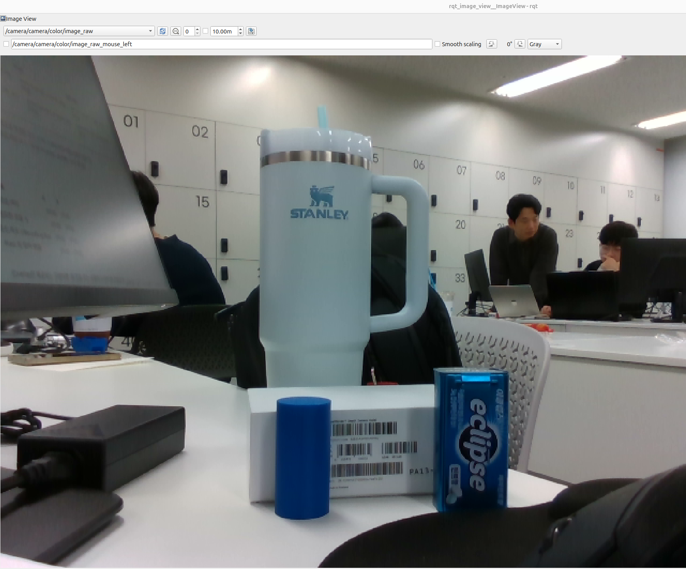 | 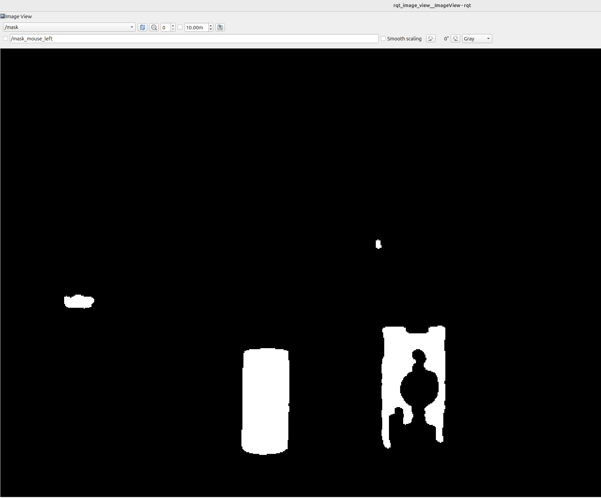 | 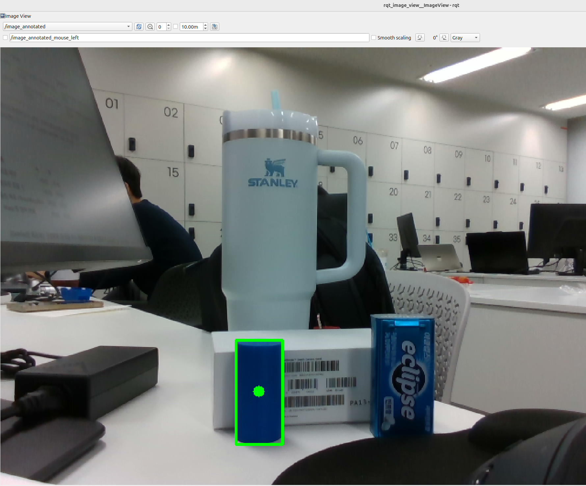 | `results/exp1_A_detect.txt`<br><br>DETECT cx=282.4 cy=376.2 area=5333 contours=3 drop_area=1 drop_circ=1                                                                                                                                                                                                                            |
| B   | 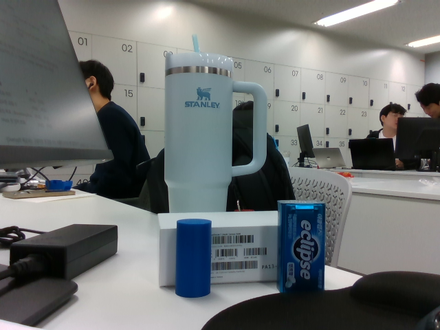 | 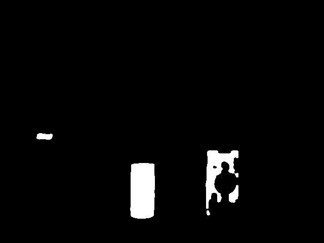   | 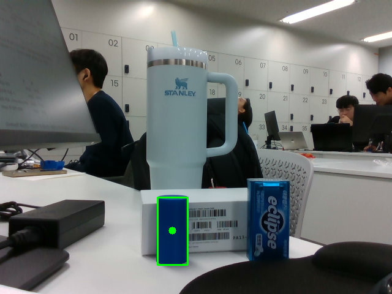 | `results/exp1_B_detect.txt`<br><br>DETECT cx=281.1 cy=376.0 area=4930 contours=5 drop_area=3 drop_circ=1<br>DETECT cx=280.9 cy=376.3 area=4917 contours=5 drop_area=3 drop_circ=1<br>DETECT cx=281.1 cy=376.1 area=4958 contours=5 drop_area=3 drop_circ=1<br>DETECT cx=280.9 cy=376.3 area=4931 contours=4 drop_area=2 drop_circ=1 |

- 같은 입력을 사용했음을 확인한 근거: 같은 카메라(RealSense D435)의 `/camera/camera/color/image_raw`(640×480, rgb8)를 사용했고 A와 B 모두 카메라와 물체(원기둥, eclipse 통, 왼쪽 뒤 파란 물체, 텀블러)의 위치를 움직이지 않았다. 두 Raw 캡처에서 물체 배치와 크기가 동일하다. 다만 ROS Image 메시지에는 프레임 번호가 없어 타임스탬프로만 구분하며  A는 stamp sec 1791787704, B는 sec 1791789294로 약 1590초(약 26분) 간격이다. 따라서 완전히 같은 프레임은 아니고 "같은 정지 장면"이다. 배경의 사람들은 움직여 Raw 캡처마다 자세가 다르다. 이 변화는 파란색 후보 영역이 아니라 Mask에 영향이 없다고 판단한다(캡처 비교 기준, 추정).
- 실제 적용한 설정값 확인 로그: `results/exp1_params.txt`에 A(`[100, 150, 50]`)와 B(`[100, 200, 50]`)를 `ros2 param get`으로 확인한 결과를 기록했다. B는 실행 중 `ros2 param set`으로 바꾸려 했으나 `inRange`에서 타입 에러(`lowerb data type = 9 is not supported`)로 노드가 종료되어 노드를 재시작하면서 `-p`로 지정해 적용했다.

### 5-4. 비교

| 비교 항목                | A (S 하한 150)                                                                 | B (S 하한 200)                                                                                                        |
| -------------------- | ---------------------------------------------------------------------------- | ------------------------------------------------------------------------------------------------------------------- |
| 목표 검출 여부             | 검출됨 (원기둥, `area=5333`)                                                       | 검출됨 (원기둥, `area=4917~4958`, 로그 4줄)                                                                                  |
| 불필요한 검출 수            | 0 (Overlay 박스는 원기둥 1개)                                                       | 0 (Overlay 박스는 원기둥 1개)                                                                                              |
| 중심 좌표 / Bounding Box | 중심 (282.55, 375.90) (echo), Box는 로그에 없고 Overlay에서 눈으로 약 x 256~307, y 320~433 | 중심 (281.19, 376.09) (echo), Box는 Overlay에서 눈으로 약 x 256~307, y 320~433                                               |
| Mask 흰 영역 변화         | 원기둥 흰 덩어리 1개, 후보 `contours=3`, 면적 탈락 1, 원형도 탈락 1                             | 원기둥 면적 약 -7% (5333 → 약 4930), 후보 `contours=4~5`, 면적 탈락 2~3, 원형도 탈락 1. eclipse 통 쪽 흰 영역에 구멍과 조각이 늘어난 것으로 보임(육안으로 확인) |

- 검출 수는 Overlay에서 사람이 눈으로 센 값이다. Bounding Box도 로그에 기록되지 않아 Overlay 박스를 눈으로 읽은 근사값이다.
- `area`는 후보로 선택된 윤곽선의 `contourArea`(`vision_node.py` 72줄)이며 Mask 전체 흰 픽셀 수가 아니다.
### 5-5. 분석

- 변화가 발생한 코드 조건 (파일:줄): `vision_node.py` 56~57줄의 `cv2.inRange(hsv, lower, upper)`가 S가 `hsv_lower1/2`의 두 번째 값 이상인 픽셀만 255로 만든다. 이 값을 150에서 200으로 올리면 S가 150~199인 픽셀이 Mask에서 빠진다. 그 결과가 후보 필터에 영향을 준 곳은 73줄(면적 필터 `area < min_area`)과 76~78줄(원형도 필터 `4πA/P² < min_circularity`)이다. B에서 `contours`가 3에서 4~5로 `drop_area`가 1에서 2~3으로 늘었다.
- 예상과 실제의 차이와 그 원인: 예상과 맞은 부분은 두 가지다. 첫째, 원기둥은 S가 252~255로 높아 B에서도 검출됐다. 둘째, eclipse 통과 왼쪽 뒤 물체는 A와 B 모두 검출되지 않았다. 다른 부분은 두 가지다. 첫째, "불필요한 Mask 영역이 줄어드는 방향"으로 예상했지만 원기둥의 area만 5333에서 약 4930으로 약 7% 줄었고 후보 수(`contours`)는 오히려 늘었다. 원기둥 가장자리처럼 S가 200보다 낮은 일부 픽셀이 빠진 결과로 보인다(추정). 둘째, eclipse 통은 S가 117~255에 걸쳐 있어(추정) S가 150~199인 픽셀이 빠지면서 흰 영역에 구멍이 생기고 작은 조각이 늘어난 것으로 보인다(눈으로 확인한 Mask 기준). 이 작은 조각들이 면적 필터에서 탈락해 `drop_area`가 늘었을 가능성이 있다(확인 필요). eclipse 통의 큰 덩어리는 B에서도 원형도 필터에서 탈락했다(`drop_circ=1`로 A와 같음). 왼쪽 뒤 물체는 A에서 area가 약 436으로 이미 500 미만이라 B에서도 면적 필터에서 탈락했다.
- 변화가 없었다면: 이번 실험에서는 Mask 모양과 후보 수에 변화가 있었으므로 "값이 적용되지 않았다"고 보지 않는다. 적용 여부는 `exp1_params.txt`에서 A=`[100, 150, 50]`, B=`[100, 200, 50]`로 확인했다. 최종 검출 결과(원기둥만 검출)가 A와 B에서 같았던 이유는, 목표(원기둥)의 S가 200보다 훨씬 높아 영향을 거의 받지 않았고, 탈락한 물체들은 S 하한이 아니라 면적과 원형도 필터 때문에 탈락했기 때문이다.
### 5-6. 결론

- 선택값: A
- 근거: 목표 누락은 A와 B 모두 없었다(원기둥 검출, 중심 차이 약 1.4 px). 불필요한 검출은 A와 B 모두 0개로 같았다. 다만 B는 목표의 area가 약 7% 줄었고 Mask의 조각(`contours` 3에서 4~5)이 늘어 후보 필터가 더 많은 잡음 조각을 걸러내야 했으며 검출 결과를 개선하는 이득은 없었다. 따라서 목표 영역이 더 온전하게 남고 후보 수가 적은 A를 선택한다.
- 다른 조명·거리·배경에도 같은 결론을 적용할 수 있는가: 이번 입력(고정 카메라, 실내 조명, 원기둥 하나와 파란 물체 2개)에서 확인한 범위에 한정된다. 조명이 어두워지면 채도가 떨어져 B(200)에서 목표 픽셀이 더 빠질 수 있고 거리가 멀어지면 목표 면적이 `min_area`에 가까워질 수 있으며 비슷한 크기·모양의 파란 물체가 배경에 있으면 오검출이 생길 수 있다. 이는 이번 실험에서 확인하지 않은 추정이므로, 다른 조명·거리·배경에서도 A가 낫다고 단정하지 않는다.

---

## 6. 실험 2 — 검출 후보를 선택하는 값

### 6-1. 가설 (실행 전 작성)

- 선택한 값의 의미: `min_area`는 후보 윤곽선(Contour)의 면적 하한이다. `vision_node.py` `detect()` 73줄에서 `cv2.contourArea`가 이 값보다 작은 후보를 탈락시킨다. Mask를 만드는 `make_mask`(51~62줄)보다 뒤에 오는 후보 필터이다. 
- A·B 값과 단위: A=500.0, B=6000.0 (단위 px², 0 이상의 실수). HSV는 `[100,150,50]~[130,255,255]`로 고정한다. 
- 예상 변화와 이유: B에서는 파란색 원기둥을 검출하지 못할 것이다. 기준값 A 로그에서 원기둥의 `area`가 5333(실시간 카메라 한 프레임 기준)으로 6000보다 작아 면적 필터에서 탈락하기 때문이다. 

### 6-2. 통제 조건

- 입력 프레임/구간: 라이브 Camera(RealSense D435)로 본 정지 장면. 카메라와 물체(파란 원기둥, eclipse 통, 텀블러) 위치를 움직이지 않았고 왼쪽 뒤 파란 물체만 움직였다.A와 B를 같은 장면에서 노드 재시작 없이 `ros2 param set`으로 값만 바꿔 연달아 캡처했다. 캡처 시각은 `results/exp2_A_grab.txt`, `results/exp2_B_grab.txt`의 stamp로 기록했다. 입력이 프레임마다 조금씩 달라질 수 있다.
- 해상도: 640×480 (Raw encoding rgb8, 약 30 Hz)
- HSV 설정 (실험 2 내내 동일): `hsv_lower1`·`hsv_lower2`=`[100, 150, 50]`, `hsv_upper1`·`hsv_upper2`=`[130, 255, 255]` (`results/exp2_params.txt`로 A와 B 모두 확인)
- 고정한 나머지 설정값: `min_circularity`=0.6, 노출 자동(D435), 조명 실내 조명, 블러·모폴로지 커널은 코드 고정값. `min_area`만 500.0 → 6000.0으로 변경.
### 6-3. 수신 증거

| 구분  | Raw Image                                         | Mask                                                 | Overlay                                                       | 검출 결과                                                                                                                                                                                                                                                      |
| --- | ------------------------------------------------- | ---------------------------------------------------- | ------------------------------------------------------------- | ---------------------------------------------------------------------------------------------------------------------------------------------------------------------------------------------------------------------------------------------------------- |
| A   |  | 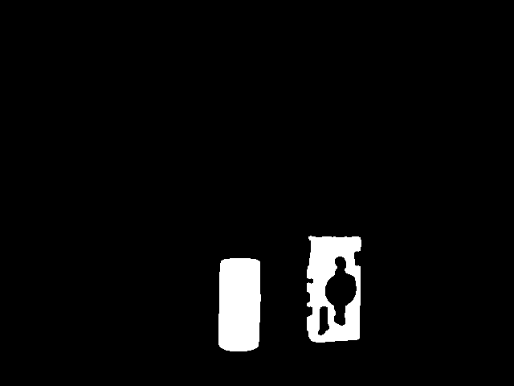  | 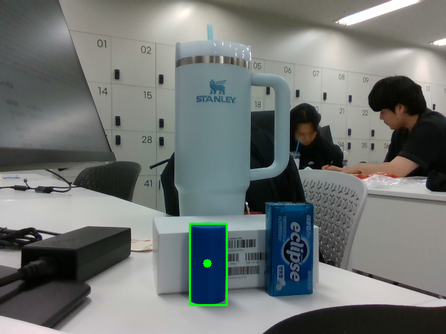 | `results/exp2_A_detect.txt`<br><br>DETECT cx=297.8 cy=378.3 area=5650 contours=2 drop_area=0 drop_circ=1<br>DETECT cx=297.8 cy=378.3 area=5648 contours=2 drop_area=0 drop_circ=1<br>DETECT cx=297.8 cy=378.3 area=5644 contours=2 drop_area=0 drop_circ=1 |
| B   | 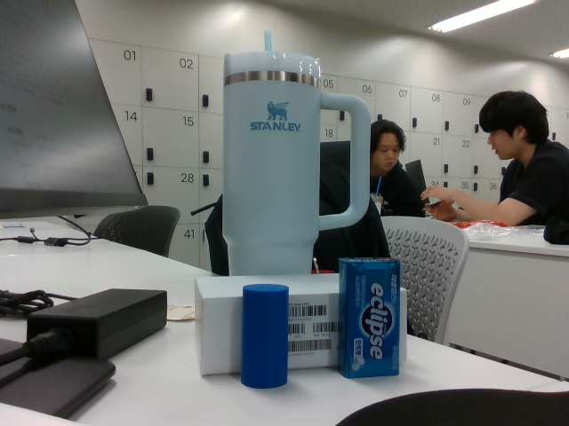 |  |      | `results/exp2_B_detect.txt` <br><br>NO DETECTION contours=2 drop_area=1 drop_circ=1                                                                                                                                                                        |

- 같은 입력을 사용했음을 확인한 근거: 원래 뒤에 있던 파란 물체만 움직이인 상태에서 노드 재시작 없이 `min_area`만 바꿔 캡처했고 두 Raw 캡처의 물체 배치가 같다. A의 `/detection` stamp는 sec 1791804676이고, 캡처 stamp는 `results/exp2_A_grab.txt`, `results/exp2_B_grab.txt`에 기록했다. B는 검출이 없어 `/detection` 메시지가 없으므로 Raw 캡처의 stamp를 시각 기록으로 쓴다. 배경의 사람들은 움직여 Raw마다 자세가 다르다.
- 실제 적용한 설정값 확인 로그: `results/exp2_params.txt` (A는 `min_area=500.0`, B는 `min_area=6000.0`, HSV는 동일)

### 6-4. 비교

| 비교 항목 | A | B |
|---|---|---|
| Contour 측정값 (각 후보의 면적 등) | 후보 2개(`contours=2`), 원기둥 `area`=5644~5650 | 후보 2개(`contours=2`), 원기둥 `area`는 A와 같은 약 5650이나 6000 미만 |
| 필터 조건 (통과/탈락 후보) | 면적 탈락 0, 원형도 탈락 1(eclipse 통), 통과 1(원기둥) | 면적 탈락 1(원기둥), 원형도 탈락 1(eclipse 통), 통과 0 |
| 목표 검출 여부 | 검출됨 | 미검출 (`/detection` 미발행, 로그 `NO DETECTION`) |
| 불필요한 검출 수 | 0 | 0 |
| 중심 좌표 / Bounding Box | 중심 (297.68, 378.30), Box는 Overlay에서 눈으로 약 x 272~326, y 320~438 | 없음 (Overlay에 박스와 점 없음) |
| Mask 영역 변화 | 원기둥과 eclipse 통의 흰 영역 | 같음 (Mask 토픽은 후보 필터 이전 단계라 변화 없음이 정상) |

### 6-5. 분석

- 통과·탈락 판정이 갈리는 코드 조건 (파일:줄): `vision_node.py` 73줄 `if area < min_area:`. 원기둥의 `area`는 약 5650(A 로그 5644~5650)이다. A의 `min_area=500.0`에서는 5650 ≥ 500이라 면적 필터를 통과했고 B의 `min_area=6000.0`에서는 5650 < 6000이라 탈락했다(B 로그 `drop_area=1`). 
- Mask 생성 단계와 후보 필터 단계가 분리되어 있다는 근거: A와 B의 Mask 그림이 같은데 검출 결과만 달라졌다(A는 검출, B는 미검출). 코드에서도 `make_mask`(51~62줄)는 `min_area`를 읽지 않고 후보 필터는 그 뒤의 `detect()`(64~89줄)에서만 `min_area`를 사용한다. `/mask`는 `make_mask`의 결과를 그대로 발행한다(94, 97~99줄).
- 예상과 실제의 차이와 그 원인: 원기둥이 B에서 검출되지 않을 것이라는 예상은 맞았다. eclipse 통이 A와 B 모두 원형도 필터로 탈락한다는 예상도 맞았다. B 로그에서 `drop_area=1`, `drop_circ=1`이고 면적 필터(73줄)가 원형도 필터(76~78줄)보다 앞이므로 원기둥은 면적에서 eclipse 통은 원형도에서 탈락했음을 알 수 있다(eclipse 통의 면적은 6000 이상으로 추정). 어긋난 점은 `drop_area`가 1에서 2로 늘 것이라는 예상이다. 실제는 0에서 1로 변했다. 왼쪽 뒤 물체는 실험 1 장면에만 있었고 이번 Mask에는 나타나지 않아(`contours=2`) 예상과 달랐다. 실험 1과 2 사이에 장면이 달라진 것이 원인이다.

### 6-6. 결론

- 선택값: A (`min_area=500.0`)
- 근거 (목표 누락, 불필요한 검출 기준): B(6000.0)에서는 목표인 파란 원기둥(`area`≈5650)이 면적 필터에서 탈락해 목표 누락이 발생했다. 반면 A에서는 목표가 검출되었고 불필요한 검출은 A와 B 모두 0개였다. 즉 B는 불필요한 검출을 더 줄이지 못하면서 목표만 잃었다. eclipse 통은 `min_area` 값과 상관없이 원형도 필터(`min_circularity=0.6`)에서 탈락했으므로 오검출을 막는 역할은 `min_area`가 아니라 원형도 필터가 하고 있다. 따라서 목표 누락이 없는 A를 선택한다.
- 적용 가능한 입력 조건과 한계: 이 결론은 이번 입력(고정 카메라, 실내 조명, 원기둥 `area`≈5650)에서 확인한 범위에 한정된다. `min_area`는 목표의 화면상 면적과 직접 비교되므로, 목표가 카메라에서 멀어져 `area`가 500에 가까워지거나 반대로 가까워져 면적이 커지는 경우에는 임계값의 적절한 범위가 달라진다. 또 이번 장면에서는 면적이 작은 불필요한 후보가 없어서 `min_area`를 올려 얻을 수 있는 이득(작은 잡음 제거)은 확인하지 못했다. 이 부분은 이번 실험으로 확인하지 못한 추정이다.

---

## 7. 목표 없는 입력 확인

- 사용한 입력: 라이브 Camera(D435)에서 파란 원기둥을 치운 정지 장면 (`results/no_target_grab.txt`)
- 적용한 설정값 (최종 선택값): S 하한 150(`hsv_lower1·2`=`[100, 150, 50]`), `min_area`=500.0 (`results/no_target_params.txt`)
- 미검출 시 검출 토픽의 표현: 메시지 미발행. `/detection`을 5초간 echo해도 메시지가 없었고, 로그는 `NO DETECTION contours=2 drop_area=1 drop_circ=1`이다.
- 메시지가 발행되지 않는 구성이라면: 코드 조건은 `vision_node.py` 102줄 `if r:`로, 검출이 없으면 `/detection`(106줄)을 발행하지 않고 `NO DETECTION` 로그만 남긴다. 입력과 처리 노드는 계속 동작했다(`/camera/camera`, `/color_detector` 모두 실행 중, Raw 약 30 Hz, `/mask` 약 2.6~5 Hz. `/mask`가 낮은 이유는 확인하지 못함).
- 증거: `results/no_target_raw.png`, `no_target_mask.png`, `no_target_overlay.png`, `no_target_detect.txt`. Mask에는 eclipse 통과 작은 점이 남았지만 각각 원형도, 면적 필터에서 탈락했고, Overlay에는 박스가 없다.
---

## 8. 선택값과 최종 결론

| 설정값 | 최종 선택값 | 선택 이유 (실험 근거와 연결) |
|---|---|---|
| S 하한 | 150 | 목표 검출과 오검출(0개)은 같았고, 200에서는 원기둥 `area`가 줄고(5333 → 약 4930) `contours`가 늘어(3 → 4~5) 이득이 없었다. |
| `min_area` | 500.0 | 6000.0에서는 원기둥(`area`≈5650)이 면적 필터에서 탈락해 목표가 누락됐다. |

- 오검출 / 미검출 차이 정리: 오검출은 모든 실험에서 0개였다. 미검출은 `min_area=6000.0`에서만 생겼고(목표 면적 < 하한), eclipse 통은 항상 원형도 필터에서 탈락했다.
- 이 결론이 유효한 입력 조건: 고정 카메라, 실내 조명, 파란 원기둥(`area`≈5300~5650)이 있는 이번 장면.
- 한계 (확인하지 못한 조명·거리·배경 등): 조명이 어둡거나 목표가 멀어지는 경우는 확인하지 못했고(추정), 실험 1과 2의 장면이 서로 달랐다.
- 관찰한 사실과 추정의 구분: 사실은 로그와 캡처의 수치이고, 물체별 S 범위, eclipse 통의 면적, 조각이 늘어난 원인, 조명·거리의 영향은 추정이다.
